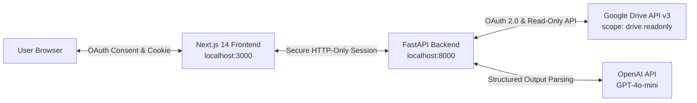

# DriveLens AI — Read-Only Document Intelligence Assistant

> **Educational & Production-Minded System:** Demonstrating how an AI assistant connects directly to Google Drive via strictly read-only OAuth 2.0, locates the most recently modified document, extracts key facts and metrics, and produces grounded summaries without requesting write permissions or manual file uploads.

[](file:///d:/skills%20&%20connectors/PROJECT%202%20%20DriveLens%20AI%20%E2%80%94%20Read-Only%20Document%20Intelligence%20Assistant/backend/tests)
[](https://developers.google.com/drive/api/guides/api-specific-auth)
[](https://platform.openai.com)
[](file:///d:/skills%20&%20connectors/PROJECT%202%20%20DriveLens%20AI%20%E2%80%94%20Read-Only%20Document%20Intelligence%20Assistant/docs/architecture.md)

---

## 1. Project Purpose & Learning Outcomes

When integrating Large Language Models with personal and enterprise storage solutions, granting write access (`https://www.googleapis.com/auth/drive`) introduces significant risk:
- **Accidental mutation or file deletion** triggered by AI hallucinations or model errors.
- **Indirect Prompt Injection:** Malicious instructions embedded in shared documents executing destructive write operations.
- **Violation of the Principle of Least Privilege (PoLP):** An assistant whose job is to summarize does not need write permission.

**DriveLens AI** proves that read-only access is fully sufficient to deliver document intelligence:
- Connects directly to Google Drive using `https://www.googleapis.com/auth/drive.readonly`.
- Selects the user's most recently modified document by sorting files by `modifiedTime desc`.
- Extracts plain text from Google Docs (via Drive export API) as well as PDF, Word (.docx), Markdown, and TXT files.
- Uses OpenAI with structured Pydantic schema enforcement to extract exactly 3 evidence-based facts, an executive one-line summary, and source citations.
- Enforces an anti-hallucination guarantee: if a document has fewer than 3 verifiable facts, it explicitly identifies the shortage instead of inventing figures.

---

## 2. Architecture Diagram



Detailed architectural diagrams and sequence flows can be found in [docs/architecture.md](file:///d:/skills%20&%20connectors/PROJECT%202%20%20DriveLens%20AI%20%E2%80%94%20Read-Only%20Document%20Intelligence%20Assistant/docs/architecture.md).

---

## 3. Prerequisites

- **OS:** Windows 10/11 (PowerShell), macOS, or Linux
- **Python:** 3.10 to 3.14+
- **Node.js:** v18+ to v24+ & npm
- **Google Cloud Account:** With access to Google Cloud Console
- **OpenAI Account:** API Key (`sk-...`)

---

## 4. Google Cloud Setup Walkthrough (Step-by-Step)

Before running the application with your real Google account, complete these steps in Google Cloud Console:

### Step 1: Create a Google Cloud Project
1. Navigate to the [Google Cloud Console](https://console.cloud.google.com/).
2. Click the project dropdown in the top header and select **New Project**.
3. Name your project (e.g., `DriveLens-AI-Project`) and click **Create**.

### Step 2: Enable the Google Drive API
1. In the search bar at the top, type `Google Drive API`.
2. Click on **Google Drive API** in the Marketplace results.
3. Click the blue **Enable** button.

### Step 3: Configure the OAuth Consent Screen
1. In the left navigation, go to **APIs & Services** > **OAuth consent screen**.
2. Select **External** user type (or **Internal** if using Google Workspace) and click **Create**.
3. Fill in required fields:
   - **App name:** `DriveLens AI`
   - **User support email:** Select your Gmail address
   - **Developer contact information:** Enter your Gmail address
4. Click **Save and Continue**.
5. On the **Scopes** page, click **Add or Remove Scopes**.
   - Search for and select: `https://www.googleapis.com/auth/drive.readonly`
   - Also select: `.../auth/userinfo.email` and `openid`
   - Click **Update**, then **Save and Continue**.
6. On the **Test users** page:
   - Click **+ Add Users** and enter your Google account email address.
   - *Note: While the app is in "Testing" status, only added test users can authorize.*
7. Click **Save and Continue** to finish.

### Step 4: Create OAuth 2.0 Client ID Credentials
1. Go to **APIs & Services** > **Credentials**.
2. Click **+ Create Credentials** at the top and select **OAuth client ID**.
3. Choose **Application type:** `Web application`.
4. Name: `DriveLens AI Web Client`.
5. Under **Authorized redirect URIs**, click **+ Add URI** and enter:
   ```
   http://localhost:8000/api/auth/callback
   ```
6. Under **Authorized JavaScript origins**, add:
   ```
   http://localhost:3000
   ```
7. Click **Create**.
8. Copy your **Client ID** and **Client Secret**.

---

## 5. Local Environment Configuration

### Backend Configuration
Create a `.env` file inside `backend/` (or copy from `backend/.env.example`):

```powershell
Copy-Item .\backend\.env.example .\backend\.env
```

Open `backend/.env` in your editor and configure the keys:

```env
# Google OAuth 2.0 (From Google Cloud Credentials)
GOOGLE_CLIENT_ID=your-client-id.apps.googleusercontent.com
GOOGLE_CLIENT_SECRET=your-client-secret
GOOGLE_REDIRECT_URI=http://localhost:8000/api/auth/callback

# Strictly read-only scope (DO NOT CHANGE)
GOOGLE_DRIVE_SCOPE=https://www.googleapis.com/auth/drive.readonly

# OpenAI API Key
OPENAI_API_KEY=sk-proj-your-openai-api-key
OPENAI_MODEL=gpt-4o-mini

# Session Cookie Encryption Key (generate via: python -c "import secrets; print(secrets.token_hex(32))")
SESSION_SECRET_KEY=94b7a4218eb24058d8c227fc62e3d360098f98ec8d2a3f78b1d6438f294ab69e

# Host & Frontend URL
HOST=0.0.0.0
PORT=8000
FRONTEND_URL=http://localhost:3000
ENVIRONMENT=development
```

### Frontend Configuration
Create a `.env.local` file inside `frontend/` (or copy from `frontend/.env.example`):

```powershell
Copy-Item .\frontend\.env.example .\frontend\.env.local
```

Ensure it contains:
```env
NEXT_PUBLIC_API_URL=http://localhost:8000
```

---

## 6. Windows 11 PowerShell Setup & Execution Commands

### Step 1: Install Dependencies

```powershell
# In workspace root:
# 1. Backend Python virtual environment & dependencies
python -m venv .\backend\venv
.\backend\venv\Scripts\pip install -r .\backend\requirements.txt

# 2. Frontend Node dependencies
cd frontend
npm install
cd ..
```

### Step 2: Run Automated Unit Tests
To verify all 25 security, OAuth, Drive ordering, text extraction, and analyzer tests:

```powershell
.\backend\venv\Scripts\pytest -v .\backend\tests
```

### Quick Launch: Unified Single-Link Mode (Recommended)

Run the single launcher script from your project root:

```powershell
.\run.ps1
```

This single command launches the FastAPI backend and serves the compiled Next.js frontend together on:

👉 **[http://localhost:8000](http://localhost:8000)**

*(It will automatically open your default browser. Both the UI and API run on this one link without needing two separate ports!)*

---

### Alternative: Standalone Development Mode (Two Terminals)

---

## 7. Illustrative Output Example

*(The following output demonstrates the structured intelligence format produced from a real document)*

```json
{
  "document_id": "1A2B3C4D5E6F7G8H9I0J",
  "document_title": "DriveLens AI - Product Roadmap & Q3 Metrics.gdoc",
  "mime_type": "application/vnd.google-apps.document",
  "last_modified": "2026-10-12T19:42:10.000Z",
  "key_facts": [
    "Q3 annual recurring revenue reached $4.2M, representing a 28% year-over-year growth rate.",
    "User retention at Day 90 improved to 81.4% following the new automated onboarding flow.",
    "Enterprise subscriptions accounted for 64% of net new annual contract value."
  ],
  "one_line_summary": "Q3 roadmap delivery achieved $4.2M ARR driven by strong enterprise tier expansion and improved Day 90 retention.",
  "source_evidence": [
    "ARR closed at $4.2M (+28% YoY)",
    "Day 90 retention hit 81.4% (up from 72.1%)",
    "Enterprise tier generated 64% of net new ACV"
  ],
  "limitations": [
    "Document does not report server infrastructure costs or gross profit margins.",
    "Regional breakdown is omitted for non-North American accounts."
  ],
  "read_only_notice": "Retrieved via strictly read-only Google Drive API. No file modification, creation, or deletion capabilities exist."
}
```

### Insufficient Evidence Handling (Anti-Hallucination)
When an analyzed document contains only one factual statement (e.g. an office closure notice), DriveLens AI explicitly notes the shortage:
```json
{
  "key_facts": [
    "The corporate office will be closed on Friday, October 16th for scheduled maintenance.",
    "[Fact shortage: Document contains insufficient additional verifiable facts]",
    "[Fact shortage: Document contains insufficient additional verifiable facts]"
  ]
}
```

---

## 8. Revoking Access & Credential Safety

Users retain complete control over access permissions:
1. **In-App Disconnect:** Click the **Disconnect Drive** button on the dashboard. This immediately issues a revocation call to `https://oauth2.googleapis.com/revoke` and clears your session cookie.
2. **Google Account Revocation:** Visit [Google Account Third-Party Access](https://myaccount.google.com/permissions), find **DriveLens AI**, and click **Remove Access**.

---

## 9. Live Connector Verification Checklist

- [x] Python virtual environment created with all pinned dependencies.
- [x] 25 unit and integration tests passing covering OAuth, CSRF state, Drive ordering, text extraction, anti-hallucination, and scope auditing.
- [x] Next.js 14 frontend compiled and verified.
- [ ] Google Cloud Project created and Drive API enabled (User manual step).
- [ ] OAuth Client ID & Secret generated with redirect URI `http://localhost:8000/api/auth/callback` (User manual step).
- [ ] `.env` file populated with real credentials and OpenAI API key (User manual step).
- [ ] Live end-to-end OAuth connection executed in browser.
- [ ] Real latest document analyzed and verified against Google Drive timestamp.
