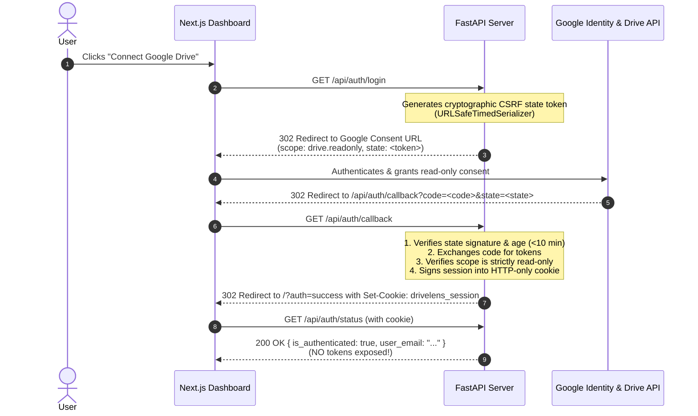

# DriveLens AI — Architecture & Security Specification

## 1. Executive Summary

**DriveLens AI** is a production-minded educational system that demonstrates how an AI assistant can safely extract document intelligence from Google Drive without requesting mutating permissions.

A common failure mode in AI agent integrations is over-permissioning: requesting full read/write Drive access (`https://www.googleapis.com/auth/drive`) when the task only involves reading. DriveLens AI establishes an uncompromising **least-privilege boundary**:
1. It requests strictly `https://www.googleapis.com/auth/drive.readonly`.
2. It contains zero write-capable methods or endpoints.
3. It validates OAuth states against CSRF.
4. It isolates tokens in signed HTTP-only cookies, keeping them away from browser code and logs.
5. It uses OpenAI with structured Pydantic schema validation to eliminate hallucinations and adhere strictly to source evidence.

---

## 2. End-to-End System Architecture

```mermaid
flowchart TD
    subgraph Client["Frontend Layer (Next.js 14)"]
        UI["DriveLens Dashboard"]
        RO_Badge["Read-Only Indicator"]
        SummaryCard["3-Fact & Summary Display"]
    end

    subgraph Backend["FastAPI Application Server"]
        Router["API Router (main.py)"]
        AuthModule["OAuth & Session (auth.py, security.py)"]
        DriveModule["ReadOnlyDriveClient (drive_client.py)"]
        Extractor["DocumentExtractor (document_extractor.py)"]
        Analyzer["DocumentAnalyzer (analyzer.py)"]
    end

    subgraph External["Google & AI Services"]
        GoogleOAuth["Google OAuth 2.0 Server"]
        GoogleDrive["Google Drive API v3 (Read-Only)"]
        OpenAI["OpenAI API (GPT-4o / GPT-4o-mini)"]
    end

    UI -->|1. Connect Drive| Router
    Router -->|2. Redirect to Consent| GoogleOAuth
    GoogleOAuth -->|3. Callback with Code & State| AuthModule
    AuthModule -->|4. Store Tokens in HTTP-only Cookie| UI

    UI -->|5. Analyze Most Recent Document| Router
    Router -->|6. Fetch Recent Docs (orderBy: modifiedTime desc)| DriveModule
    DriveModule -->|7. Query list() & get_media()/export()| GoogleDrive
    GoogleDrive -->|8. Return File Content Bytes| Extractor
    Extractor -->|9. Plaintext String| Analyzer
    Analyzer -->|10. Structured Prompt (Untrusted Data)| OpenAI
    OpenAI -->|11. Pydantic-Validated 3 Facts & Summary| Analyzer
    Analyzer -->|12. Final Analysis JSON| SummaryCard
```

---

## 3. Google OAuth 2.0 Flow & State CSRF Verification



---

## 4. Why Read-Only? Privilege Comparison & Least-Privilege Proof

| Permission Scope | Read Files | List Metadata | Create / Upload | Edit Files | Delete / Trash | Share / Permissions | DriveLens Policy |
| :--- | :---: | :---: | :---: | :---: | :---: | :---: | :---: |
| `https://www.googleapis.com/auth/drive` | Yes | Yes | Yes | Yes | Yes | Yes | **FORBIDDEN (Rejected)** |
| `https://www.googleapis.com/auth/drive.file` | Yes | Yes | Yes | Yes | Yes | Yes | **FORBIDDEN (Rejected)** |
| `https://www.googleapis.com/auth/drive.metadata.readonly` | No (Meta only) | Yes | No | No | No | No | Inadequate for text extraction |
| `https://www.googleapis.com/auth/drive.readonly` | **Yes** | **Yes** | **No** | **No** | **No** | **No** | **ENFORCED DEFAULT** |

### Why Write Access Is Unnecessary
The task of an intelligence assistant is purely investigative and explanatory. Asking for write permissions exposes the user's entire cloud storage to accidental overwrites, file corruption, or malicious prompt injection instructions that attempt to alter or delete documents. Enforcing `drive.readonly` at the OAuth scope level guarantees that even in the worst-case scenario, the assistant can never mutate user files.

---

## 5. Defense-in-Depth Implementation Layers

1. **OAuth Scope Guard**: `app/config.py` uses a Pydantic validator that throws an exception if any non-read-only Drive scope is configured.
2. **Structural Class Audit**: `ReadOnlyDriveClient` in `app/drive_client.py` has zero `create`, `upload`, `update`, `patch`, or `delete` methods.
3. **API Route Audit**: Automated tests inspect all FastAPI routes to verify no file modification endpoints exist.
4. **Untrusted Data Isolation**: Document content is wrapped in strict demarcation delimiters (`---BEGIN DOCUMENT CONTENT---`) in the OpenAI system prompt, instructing the model to treat document content strictly as passive data and ignore prompt injection attempts.
5. **Anti-Hallucination & Shortage Guarantee**: If a document has fewer than 3 verifiable facts, the analyzer outputs explicit `[Fact shortage]` items instead of inventing details.
6. **Token Leakage Prevention**: Access and refresh tokens are kept exclusively in cryptographically signed, HTTP-only server-side cookies. No client JavaScript or API responses ever receive tokens.
